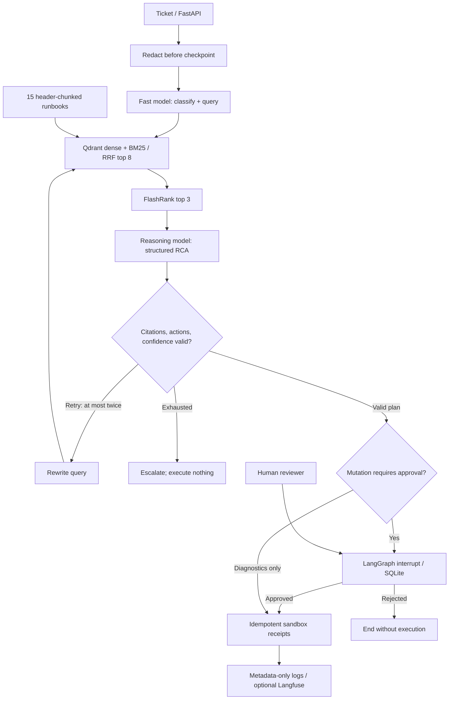

# SentinelOps

**Autonomous IT & Cloud Incident Triage & Remediation Agent**

An incident arrives with an error code, a vague symptom and credentials that should never have been pasted into a ticket. SentinelOps redacts sensitive data, retrieves operational evidence, proposes a cited root-cause hypothesis and pauses for a human decision before recording a mutating remediation simulation.

Built as a **Senior Gen AI Engineer portfolio reference**, with FastAPI, LangGraph, Qdrant hybrid retrieval, structured model outputs and durable approval state. Execution is deliberately sandbox simulation: this repository never runs shell commands or modifies cloud infrastructure.

> **Verification status:** implementation and test suites are included. The authoring environment has Python 3.9, no uv/Docker and blocked dependency downloads. Full Python 3.12 tests, Ruff, model evaluation and Docker validation have **not yet run**. See [verification evidence](docs/VERIFICATION.md). Do not represent this as a production-deployed or benchmarked system.

## Business impact

- Reduce repeated manual runbook lookup by producing an evidence-backed initial hypothesis.
- Give on-call engineers a consistent report: severity, category, citations, confidence and proposed actions.
- Preserve human control over mutations, including rejection and restart/resume workflows.
- Keep pasted credentials out of model requests, saved checkpoints and telemetry.
- Measure retrieval and generation changes through reproducible offline tests and opt-in quality gates.

Actual MTTR reduction, inference savings and recovery outcomes need measurement in a real operational environment. No improvement percentage is invented here.

## Architecture



`interrupt()` intentionally has no exception wrapper. LangGraph restarts that node on resume, so execution lives in a separate downstream node. SQLite receipts keyed by thread/action prevent duplicate simulated effects after execution-node replay.

## Quickstart — three steps

Prerequisite: Docker Engine/Desktop with Compose v2. The default Compose deployment uses free deterministic mocks and a real Qdrant server, so no OpenAI key is needed.

**1. Start the stack**

```bash
docker compose up --build
```

Run the remaining commands in a second terminal. API: `http://localhost:8000`; Swagger: `http://localhost:8000/docs`.

**2. Ingest the runbooks, then submit an incident**

```bash
curl -sS -X POST http://localhost:8000/ingest
curl -sS -X POST http://localhost:8000/triage \
  -H 'Content-Type: application/json' \
  -d '{"text":"Production outage: HTTP 502 Bad Gateway after an upstream deployment. Contact ops@example.test; host 10.0.0.8; password=demo-only"}'
```

Expect `status: "awaiting_approval"`, an `IncidentReport`, a UUID `thread_id` and an empty execution log. Copy the returned UUID.

**3. Inspect and approve the plan**

```bash
THREAD_ID='<returned UUID>'
curl -sS "http://localhost:8000/threads/$THREAD_ID"
curl -sS -X POST "http://localhost:8000/approve/$THREAD_ID" \
  -H 'Content-Type: application/json' \
  -d '{"approved":true,"reviewer_note":"Reviewed the proposed sandbox plan"}'
```

Expect `status: "completed"` with `mode: "simulation"` receipts. Use `"approved": false` to reject. A second approval returns HTTP 409. Shut down with `docker compose down`; persistent volumes retain checkpoints and Qdrant data.

## Local development with Python 3.12 and uv

```bash
uv python install 3.12
uv sync
MOCK_LLM=true uv run uvicorn app.main:app --host 127.0.0.1 --port 8000 --workers 1
```

The first `uv sync` generates `uv.lock`. Verify and commit it before release; subsequent installations should use `uv sync --frozen`. A lockfile could not be generated in the disconnected authoring environment. The Dockerfile currently resolves from `pyproject.toml`; switch it to frozen lockfile installation once that lock is committed.

```bash
uv run ruff check .
MOCK_LLM=true RUN_LLM_EVALS=false uv run pytest -v
MOCK_LLM=true uv run python scripts/demo_run.py
docker compose config --quiet
```

`bash scripts/verify.sh` runs those gates together. `python3 scripts/check_repository.py` is a limited dependency-free structural check, **not a substitute for unit/integration tests**.

### Free versus real model modes

| Mode | Configuration | Behavior / cost |
|---|---|---|
| Offline demo / tests | `MOCK_LLM=true` | Deterministic classifier/RCA, hashed dense test vectors, sparse term weights and lexical test reranking; real Qdrant fusion. No downloads or model API calls. |
| Real retrieval, mock generation | `MOCK_LLM=true RETRIEVAL_BACKEND=fastembed` | FastEmbed dense + BM25 and FlashRank; initial model downloads, no paid LLM requests. |
| Full Gen AI | `MOCK_LLM=false OPENAI_API_KEY=...` | `gpt-4o-mini` classification/rewrite, `gpt-4o` RCA, real hybrid retrieval. OpenAI usage can incur charges. |

Do not compare mock scores with semantic model benchmarks. `RETRIEVAL_BACKEND` is never silently changed after a model download failure.

For real mode, copy `.env.example` to `.env`, add a key locally and set `MOCK_LLM=false`. `.env` is ignored by Git. Local Qdrant persists at `.sentinel/qdrant`; select `QDRANT_MODE=memory` for ephemeral data, or `QDRANT_MODE=server` with `QDRANT_URL` for a server. Compose always selects server mode at `http://qdrant:6333`.

Optional Langfuse requires both `LANGFUSE_PUBLIC_KEY` and `LANGFUSE_SECRET_KEY`; only transition metadata is sent. Tickets, retrieved documents, reviewer notes and RCA content are excluded from telemetry.

## API contracts

| Endpoint | Purpose | Important responses |
|---|---|---|
| `GET /health` | Liveness and explicit operating mode | 200; does not claim Qdrant readiness |
| `POST /ingest` | Idempotently index 15 local Markdown runbooks | Runbook count, chunk count, backend |
| `POST /triage` | Accept `text` and optional UUID `thread_id` | Completed, awaiting approval or escalated; 409 for empty KB / reused ID |
| `POST /approve/{thread_id}` | Resume with strict Boolean `approved` and optional `reviewer_note` | Completed or denied; 409 if no pending approval |
| `GET /threads/{thread_id}` | Inspect sanitized checkpoint state and next node | 404 unknown; 422 malformed UUID |

`IncidentReport` contains `root_cause`, `confidence_score` (0–1), `cited_runbook_ids`, `proposed_commands`, and `requires_approval`. Inputs reject unknown fields and string-valued approval booleans.

For local tooling, set `API_TOKEN` to require `Authorization: Bearer <token>` on all incident/data endpoints. Health remains public. The reference Compose binding is loopback only. Reviewer role separation and user-level authorization belong at the production identity gateway; the demo token alone does not establish reviewer identity.

## Architectural trade-offs

**Hybrid search + reranking versus dense-only RAG.** Dense retrieval helps with paraphrased symptoms; BM25 retains literal identifiers such as `0x80070005` and `OOMKilled`, which embedding-only ranking can blur. Qdrant prefetches eight candidates per named vector, fuses with reciprocal rank fusion to eight, then FlashRank selects three. Header chunks keep procedures intact and repeat title/error metadata. This is a reasoned design choice, not a universal measured win; compare dense-only, sparse-only and hybrid ablations before claiming superiority. Larger corpora need tuned candidate depth and chunk budgets.

**Multi-model routing versus one expensive model.** Classification and query rewriting use `gpt-4o-mini`; the evidence-heavy report uses `gpt-4o`. Routing reserves the more expensive reasoning request for the synthesis stage. Actual savings depend on token counts, retry rates and model pricing; measure both quality and cost before reporting a percentage.

**Evaluation gates versus prompt-only review.** Offline golden-ticket checks catch missing identifiers and broken approval behavior without an LLM judge. The opt-in real-model job additionally gates Faithfulness ≥ **0.85**, Contextual Recall ≥ **0.80**, expected citations and expected remediation. This helps catch prompt regressions that still produce valid JSON. Judge metrics are stochastic and can be biased; preserve cases and inspect failure reasons. Run this job and require it in branch protection for prompt/model releases. Ordinary offline CI alone does not certify semantic quality.

**SQLite versus distributed persistence.** SQLite and local Qdrant make development easy and avoid cloud setup. One API worker serializes graph, approval and ingestion operations. This bounds throughput and is not a distributed exactly-once design. Before horizontal deployment, adopt a shared checkpointer, distributed approval claims and idempotency at each external execution provider.

**Safety versus autonomy.** Confidence <0.75 or missing/invalid citations triggers at most two query rewrites. Exhaustion ends in escalation with no commands. A model's approval claim cannot override the action registry. Exact command strings and cited runbook provenance are validated in code. These checks limit unsafe plans but do not prove the RCA is correct.

## Knowledge base

15 synthetic, detailed runbooks, each with scope, symptoms, three diagnostic steps, a cause hypothesis, approval rules, verification/rollback and a post-mortem:

| Domain | Topics |
|---|---|
| Linux | Inode exhaustion / ENOSPC; systemd crash / start-limit-hit; OOMKilled / exit 137 |
| AWS | IAM AccessDenied; EC2 SSH timeout; S3 403 / SSE-KMS |
| Networking | DNS NXDOMAIN; HTTP 502 Bad Gateway; expired TLS certificate |
| Kubernetes | CrashLoopBackOff; ImagePullBackOff / ErrImagePull |
| Identity / Windows | AD event 4740 / lockout; 0x80070005; BitLocker recovery; VPN RADIUS timeout |

These are original synthetic training scenarios, not claims of real incident response experience.

## Benchmarks and evaluation

| Metric | Gate / dataset | Measured result |
|---|---|---|
| Exact-code retrieval hit@3 | `0x80070005`, `HTTP 502`, `OOMKilled` | Pending execution |
| Golden runbook recall@3 | 20 tickets, 15 runbooks | Pending execution |
| Faithfulness | ≥0.85 for every online case | Not run; OpenAI judge required |
| Contextual Recall | ≥0.80 for every online case | Not run; OpenAI judge required |
| Triage p50 / p95 latency | Real models; report warm/cold cache | TBD |
| Tokens / cost per incident | Classification + synthesis + retries | TBD |
| Approval/rejection/restart safety | Deterministic integration suite | Pending execution |

Run real retrieval tests without an OpenAI key:

```bash
RUN_MODEL_TESTS=true MOCK_LLM=true uv run pytest -v -m models
```

Run the 20 paid generation/judge cases:

```bash
OPENAI_API_KEY='<your key>' RUN_LLM_EVALS=true uv run pytest -v evals/test_rag_eval.py
```

In CI, set the OpenAI repository secret and manually dispatch `run_quality_eval=true`. A requested online job fails if the secret is missing; offline CI skips those metrics with a clear reason. CI also validates Compose and runs a real container/Qdrant HTTP smoke test.

## Production rollout boundary

This is an engineering reference awaiting full verification, not an unattended cloud operator. See [operations and limitations](docs/OPERATIONS.md) for deployment prerequisites, privacy scope, recovery, resource sizing and execution-adapter requirements. There is no real remediation switch hidden behind an environment variable.

## Portfolio story

> Built SentinelOps, a checkpointed incident-triage reference using LangGraph, Qdrant dense/BM25 retrieval, cross-encoder reranking and structured multi-model routing, with approval-gated, idempotent remediation simulations and a 20-ticket evaluation harness.

Add measured quality, latency and cost results only after running the corresponding suites. [Project walkthrough and interview explanation](docs/PROJECT_GUIDE.md) explains the design, demo and honest CV/LinkedIn positioning.

## Technical references

- [LangGraph interrupt and replay semantics](https://reference.langchain.com/python/langgraph/types/interrupt)
- [Qdrant hybrid queries and fusion](https://qdrant.tech/documentation/search/hybrid-queries/)
- [FlashRank reranking](https://github.com/PrithivirajDamodaran/FlashRank)
- [uv container integration](https://docs.astral.sh/uv/guides/integration/docker/)

## Repository map

```text
app/                 API, contracts, redaction, retrieval, graph, sandbox tools
data/runbooks/      15 synthetic runbooks (105 header chunks)
tests/              Offline guardrail, retrieval, graph, API and replay tests
evals/              20 golden tickets and opt-in real-model DeepEval gates
scripts/            Demo, container smoke and verification entry points
docs/               Operations, project guide and verification record
.github/workflows/  Offline, container and opt-in paid evaluation CI jobs
```

## Push to GitHub

Git initialization was blocked in the authoring environment. After verification, `scripts/initialize_git.sh` creates branch `main` and four conventional commits. Review the verification record and commit the generated `uv.lock`, then:

```bash
git remote add origin https://github.com/YOUR_USERNAME/sentinel-ops.git
git push -u origin main
```

If this environment could not create Git metadata, run `bash scripts/initialize_git.sh` on your unrestricted machine after installing the prerequisites. To create a Desktop source copy, run `python3 scripts/export_desktop.py`.

Create an empty GitHub repository first. Never add `.env`, keys, model caches or incident databases to Git.
