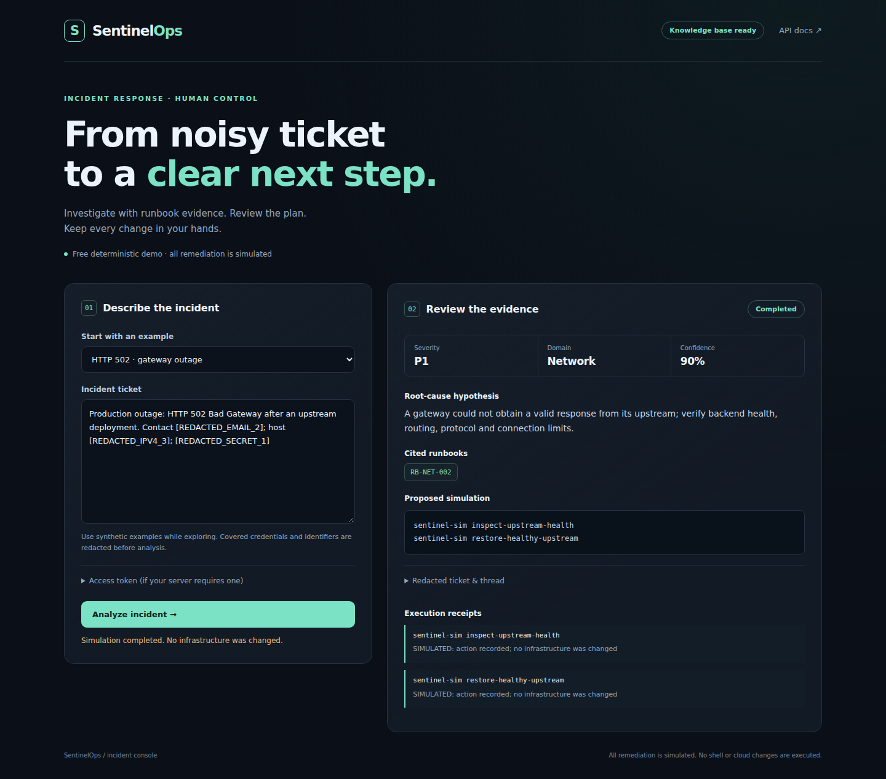
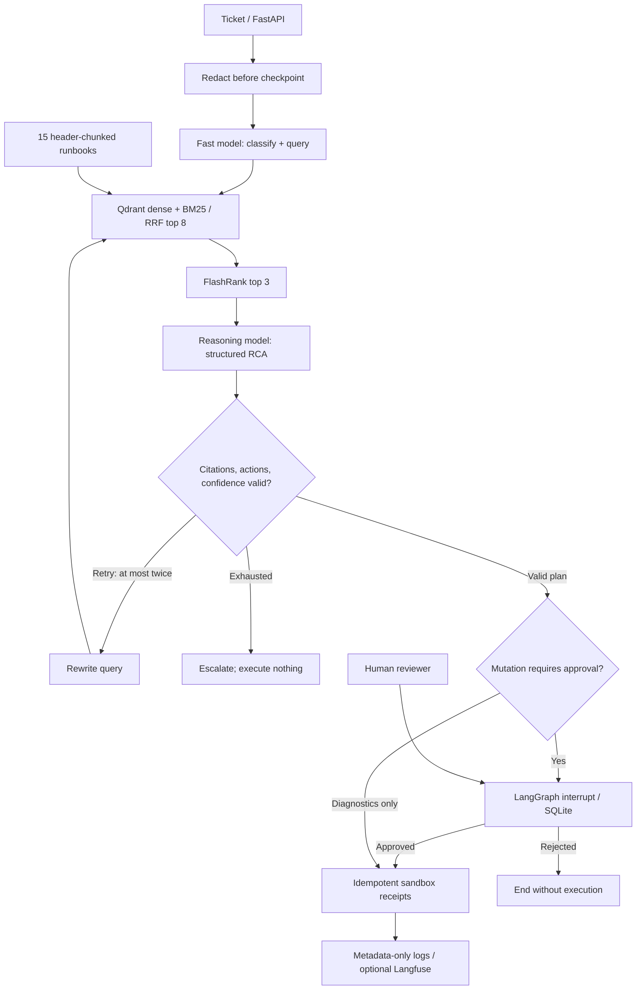

# SentinelOps

[](https://github.com/sreenivasreddy037/sentinel-ops/actions/workflows/ci.yml)

**Autonomous IT & Cloud Incident Triage & Remediation Agent**

SentinelOps turns unstructured IT and cloud incident tickets into evidence-backed diagnoses and reviewed remediation plans. It redacts sensitive data, retrieves relevant runbooks, produces a cited root-cause hypothesis, and pauses for an operator before recording a mutating action.

Built with FastAPI, LangGraph and Qdrant, SentinelOps combines hybrid retrieval, structured multi-model routing and durable approval state. The current executor records simulated actions; it does not run remediation commands or modify cloud infrastructure.

> **Verified in GitHub Actions:** Ruff clean; **74 offline tests passed**, 21 optional cases skipped in that suite; the separate real FastEmbed/BM25/FlashRank test also passed; browser approval/rejection/escalation, native startup on Windows/macOS/Linux, and the relocated Mac runtime all passed. Compose validated; API + Qdrant images built and the container smoke test passed. Dependencies are committed in `uv.lock`. See [verification evidence](docs/VERIFICATION.md). Paid OpenAI judge scores and production impact remain unmeasured.



## Business impact

- Reduce repeated manual runbook lookup by producing an evidence-backed initial hypothesis.
- Give on-call engineers a consistent report: severity, category, citations, confidence and proposed actions.
- Preserve human control over mutations, including rejection and restart/resume workflows.
- Keep pasted credentials out of model requests, saved checkpoints and telemetry.
- Measure retrieval and generation changes through reproducible offline tests and opt-in quality gates.

Operational MTTR, inference cost savings and recovery outcomes have not yet been benchmarked in a production environment.

## Architecture



`interrupt()` intentionally has no exception wrapper. LangGraph restarts that node on resume, so execution lives in a separate downstream node. SQLite receipts keyed by thread/action prevent duplicate simulated effects after execution-node replay.

## Run the project

Download and extract the [source ZIP](https://github.com/sreenivasreddy037/sentinel-ops/archive/refs/heads/main.zip), or clone this repository. You do not need an OpenAI account for the free demo.

With Python 3.9+ and pip installed, run **`bash start.sh`** on Mac/Linux or **`start.cmd`** on Windows. The launcher installs project-local uv, Python 3.12 and the locked dependencies, indexes the bundled runbooks, and opens the incident console at **http://127.0.0.1:8000**. A prepared Apple silicon Mac runtime is also produced by CI.

See [first-time setup and troubleshooting](docs/GETTING_STARTED.md) for all launch options, prerequisites and the optional real AI mode.

## Docker quickstart — three steps

Prerequisite: Docker Engine/Desktop with Compose v2. Python and Qdrant run inside the containers. The default demo needs no API key.

**1. Start and wait for automatic indexing**

```bash
docker compose up --build --detach --wait
```

**2. Open the incident console**

Visit **http://localhost:8000**, choose an example and click **Analyze incident**. The console shows the redacted ticket, cited hypothesis and proposed commands.

**3. Approve or reject the sandbox plan**

Use the console buttons. Approved plans produce simulation receipts; rejected plans execute nothing. Stop with `docker compose down`.

Prefer the API? Startup already indexed the knowledge base; `/ingest` is available for explicit reindexing.

```bash
curl -sS -X POST http://localhost:8000/triage \
  -H 'Content-Type: application/json' \
  -d '{"text":"Production outage: HTTP 502 Bad Gateway after an upstream deployment"}'

THREAD_ID='<returned UUID>'
curl -sS -X POST "http://localhost:8000/approve/$THREAD_ID" \
  -H 'Content-Type: application/json' \
  -d '{"approved":true,"reviewer_note":"Reviewed the proposed sandbox plan"}'
```

## Local development with Python 3.12 and uv

```bash
uv python install 3.12
uv sync --frozen
MOCK_LLM=true uv run uvicorn app.main:app --host 127.0.0.1 --port 8000 --workers 1
```

Use `uv sync --frozen` for reproducible installs from the committed lockfile. To deliberately update dependencies, run `uv lock --upgrade`, verify the full suite and commit the new lock. CI and the Docker builder also install from the frozen lock.

```bash
uv run ruff check .
MOCK_LLM=true RUN_LLM_EVALS=false uv run pytest -v
MOCK_LLM=true uv run python scripts/demo_run.py
docker compose config --quiet
```

`bash scripts/verify.sh` runs those gates together. `python3 scripts/check_repository.py` is a limited dependency-free structural check, **not a substitute for unit/integration tests**.

### Free versus real model modes

| Mode | Configuration | Behavior / cost |
|---|---|---|
| Offline demo / tests | `MOCK_LLM=true` | Deterministic classifier/RCA, hashed dense test vectors, sparse term weights and lexical test reranking; real Qdrant fusion. No downloads or model API calls. |
| Real retrieval, mock generation | `MOCK_LLM=true RETRIEVAL_BACKEND=fastembed` | FastEmbed dense + BM25 and FlashRank; initial model downloads, no paid LLM requests. |
| Full Gen AI | `MOCK_LLM=false OPENAI_API_KEY=...` | `gpt-4o-mini` classification/rewrite, `gpt-4o` RCA, real hybrid retrieval. OpenAI usage can incur charges. |

Do not compare mock scores with semantic model benchmarks. `RETRIEVAL_BACKEND` is never silently changed after a model download failure.

For real mode, copy `.env.example` to `.env`, add a key locally and set `MOCK_LLM=false`. `.env` is ignored by Git. Local Qdrant persists at `.sentinel/qdrant`; select `QDRANT_MODE=memory` for ephemeral data, or `QDRANT_MODE=server` with `QDRANT_URL` for a server. Compose always selects server mode at `http://qdrant:6333`.

Optional Langfuse requires both `LANGFUSE_PUBLIC_KEY` and `LANGFUSE_SECRET_KEY`; only transition metadata is sent. Tickets, retrieved documents, reviewer notes and RCA content are excluded from telemetry.

## API contracts

| Endpoint | Purpose | Important responses |
|---|---|---|
| `GET /` | Browser incident console | Analyze, inspect, approve or reject |
| `GET /health` | Liveness and explicit operating mode | 200; does not claim Qdrant readiness |
| `GET /ready` | Knowledge-store readiness | 200 indexed; 503 unavailable |
| `POST /ingest` | Idempotently index 15 local Markdown runbooks | Runbook count, chunk count, backend |
| `POST /triage` | Accept `text` and optional UUID `thread_id` | Completed, awaiting approval or escalated; 409 for empty KB / reused ID |
| `POST /approve/{thread_id}` | Resume with strict Boolean `approved` and optional `reviewer_note` | Completed or denied; 409 if no pending approval |
| `GET /threads/{thread_id}` | Inspect sanitized checkpoint state and next node | 404 unknown; 422 malformed UUID |

`IncidentReport` contains `root_cause`, `confidence_score` (0–1), `cited_runbook_ids`, `proposed_commands`, and `requires_approval`. Inputs reject unknown fields and string-valued approval booleans.

For local tooling, set `API_TOKEN` to require `Authorization: Bearer <token>` on all incident/data endpoints. Health remains public. The default Compose binding is loopback only. Reviewer role separation and user-level authorization belong at the production identity gateway; the demo token alone does not establish reviewer identity.

## Architectural trade-offs

**Hybrid search + reranking versus dense-only RAG.** Dense retrieval helps with paraphrased symptoms; BM25 retains literal identifiers such as `0x80070005` and `OOMKilled`, which embedding-only ranking can blur. Qdrant prefetches eight candidates per named vector, fuses with reciprocal rank fusion to eight, then FlashRank selects three. Header chunks keep procedures intact and repeat title/error metadata. This is a reasoned design choice, not a universal measured win; compare dense-only, sparse-only and hybrid ablations before claiming superiority. Larger corpora need tuned candidate depth and chunk budgets.

**Multi-model routing versus one expensive model.** Classification and query rewriting use `gpt-4o-mini`; the evidence-heavy report uses `gpt-4o`. Routing reserves the more expensive reasoning request for the synthesis stage. Actual savings depend on token counts, retry rates and model pricing; measure both quality and cost before reporting a percentage.

**Evaluation gates versus prompt-only review.** Offline golden-ticket checks catch missing identifiers and broken approval behavior without an LLM judge. The opt-in real-model job additionally gates Faithfulness ≥ **0.85**, Contextual Recall ≥ **0.80**, expected citations and expected remediation. This helps catch prompt regressions that still produce valid JSON. Judge metrics are stochastic and can be biased; preserve cases and inspect failure reasons. Run this job and require it in branch protection for prompt/model releases. Ordinary offline CI alone does not certify semantic quality.

**SQLite versus distributed persistence.** SQLite and local Qdrant make development easy and avoid cloud setup. One API worker serializes graph, approval and ingestion operations. This bounds throughput and is not a distributed exactly-once design. Before horizontal deployment, adopt a shared checkpointer, distributed approval claims and idempotency at each external execution provider.

**Safety versus autonomy.** Confidence <0.75 or missing/invalid citations triggers at most two query rewrites. Exhaustion ends in escalation with no commands. A model's approval claim cannot override the action registry. Exact command strings and cited runbook provenance are validated in code. These checks limit unsafe plans but do not prove the RCA is correct.

## Knowledge base

15 synthetic, detailed runbooks, each with scope, symptoms, three diagnostic steps, a cause hypothesis, approval rules, verification/rollback and a post-mortem:

| Domain | Topics |
|---|---|
| Linux | Inode exhaustion / ENOSPC; systemd crash / start-limit-hit; OOMKilled / exit 137 |
| AWS | IAM AccessDenied; EC2 SSH timeout; S3 403 / SSE-KMS |
| Networking | DNS NXDOMAIN; HTTP 502 Bad Gateway; expired TLS certificate |
| Kubernetes | CrashLoopBackOff; ImagePullBackOff / ErrImagePull |
| Identity / Windows | AD event 4740 / lockout; 0x80070005; BitLocker recovery; VPN RADIUS timeout |

The runbooks and post-mortems are synthetic fixtures for reproducible retrieval, diagnosis and workflow validation.

## Benchmarks and evaluation

| Metric | Gate / dataset | Measured result |
|---|---|---|
| Exact-code retrieval hit@3 | `0x80070005`, `HTTP 502`, `OOMKilled` | 3/3 cases passed (mock retrieval) |
| Real hybrid retrieval hit@3 | FastEmbed + BM25 + FlashRank; three exact-code queries | 3/3 passed in the dedicated model test |
| Golden runbook recall@3 | 20 tickets, 15 runbooks | 20/20 expected IDs found (mock retrieval) |
| Faithfulness | ≥0.85 for every online case | Not run; OpenAI judge required |
| Contextual Recall | ≥0.80 for every online case | Not run; OpenAI judge required |
| Triage p50 / p95 latency | Real models; report warm/cold cache | TBD |
| Tokens / cost per incident | Classification + synthesis + retries | TBD |
| Approval/rejection/restart safety | Deterministic integration suite | Passed in GitHub Actions |

Run real retrieval tests without an OpenAI key:

```bash
RUN_MODEL_TESTS=true MOCK_LLM=true uv run pytest -v -m models
```

Run the 20 paid generation/judge cases:

```bash
OPENAI_API_KEY='<your key>' RUN_LLM_EVALS=true uv run pytest -v evals/test_rag_eval.py
```

In CI, set the OpenAI repository secret and manually dispatch `run_quality_eval=true`. A requested online job fails if the secret is missing; offline CI skips those metrics with a clear reason. CI also validates Compose and runs a real container/Qdrant HTTP smoke test.

## Production rollout boundary

The current release uses simulated execution. Connecting real infrastructure requires reviewed execution adapters, organization-specific authorization and operational controls. Paid OpenAI evaluation and production impact measurements remain pending. See [operations and deployment](docs/OPERATIONS.md) for authentication, privacy, recovery, resource sizing and execution requirements.

## Why I built SentinelOps

I wanted an incident-response workflow that could turn incomplete tickets into evidence-backed plans while keeping operators in control of changes. SentinelOps separates diagnosis, retrieval, approval and execution into checkpointed stages so each decision can be inspected and resumed.

The design focuses on three priorities: preserve exact operational error codes during retrieval, ground proposed actions in runbook evidence, and make human approval an enforceable execution boundary. The [technical project guide](docs/PROJECT_GUIDE.md) explains the implementation and design decisions.

## Technical references

- [LangGraph interrupt and replay semantics](https://reference.langchain.com/python/langgraph/types/interrupt)
- [Qdrant hybrid queries and fusion](https://qdrant.tech/documentation/search/hybrid-queries/)
- [FlashRank reranking](https://github.com/PrithivirajDamodaran/FlashRank)
- [uv container integration](https://docs.astral.sh/uv/guides/integration/docker/)

## License

SentinelOps is licensed under the [MIT License](LICENSE).

## Repository map

```text
app/                 API, contracts, redaction, retrieval, graph, sandbox tools
data/runbooks/      15 synthetic runbooks (105 header chunks)
tests/              Offline guardrail, retrieval, graph, API and replay tests
evals/              20 golden tickets and opt-in real-model DeepEval gates
scripts/            Demo, container smoke and verification entry points
docs/               Operations, project guide and verification record
.github/workflows/  Offline, container and opt-in paid evaluation CI jobs
```

## Get the source

```bash
git clone https://github.com/sreenivasreddy037/sentinel-ops.git
cd sentinel-ops
uv sync --frozen
```

Use the native launcher for first-time setup, or install from `uv.lock` for development. Runtime environments, credentials and incident data stay out of Git.

To create a separate Desktop source copy, run `python3 scripts/export_desktop.py`; it excludes credentials and incident data and refuses to overwrite an existing folder. Never add `.env`, keys, model caches or incident databases to Git.
